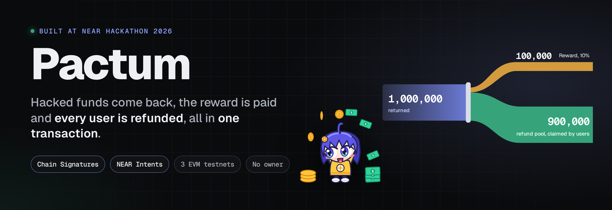
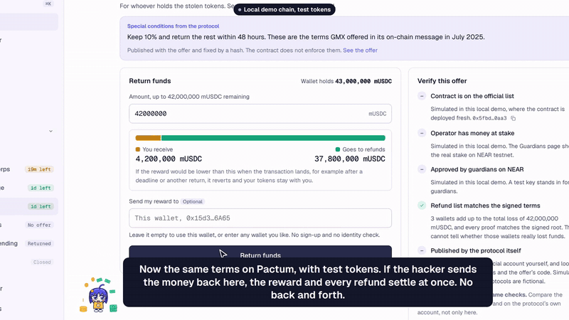
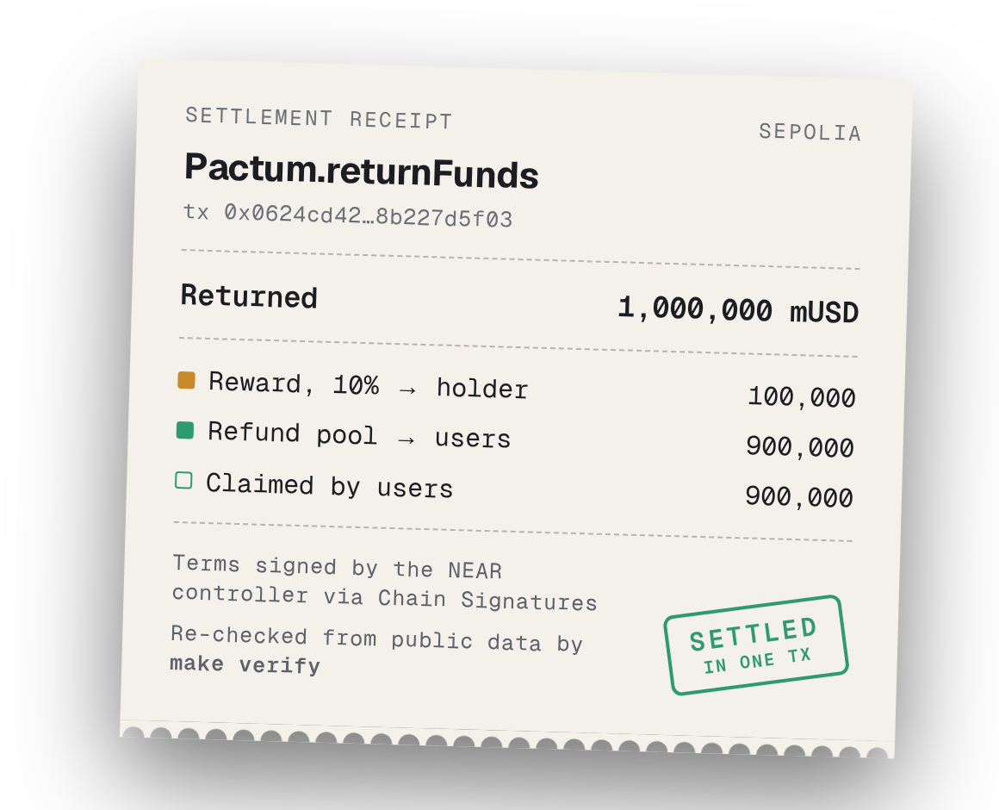
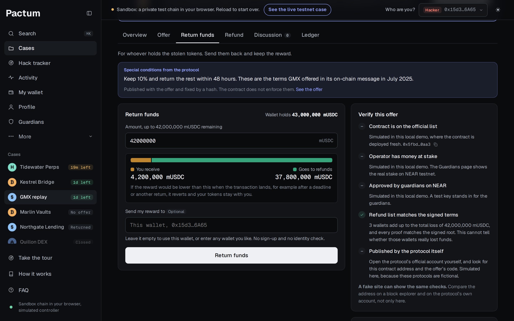
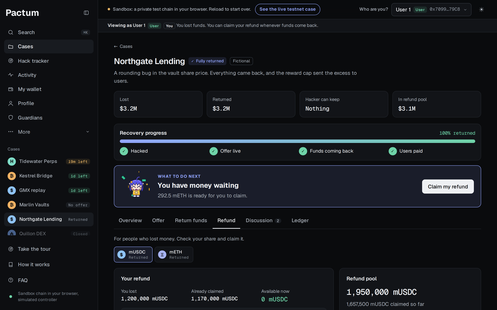
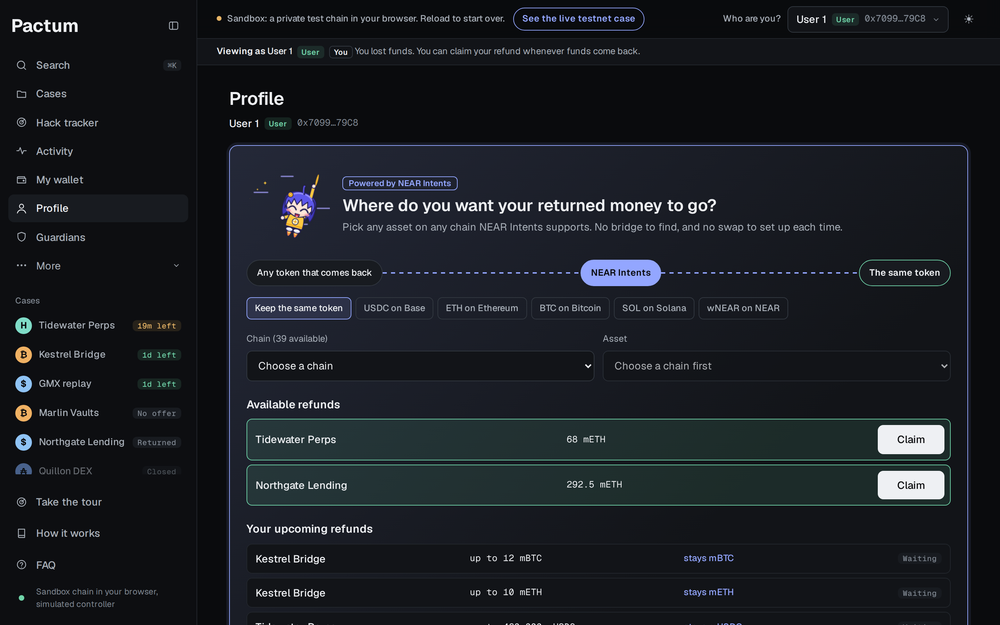
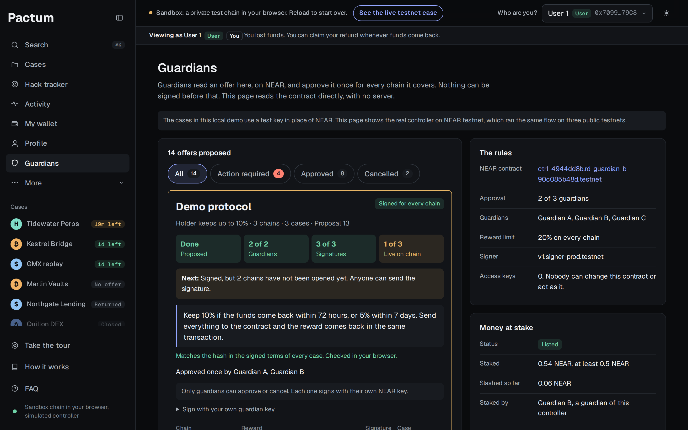
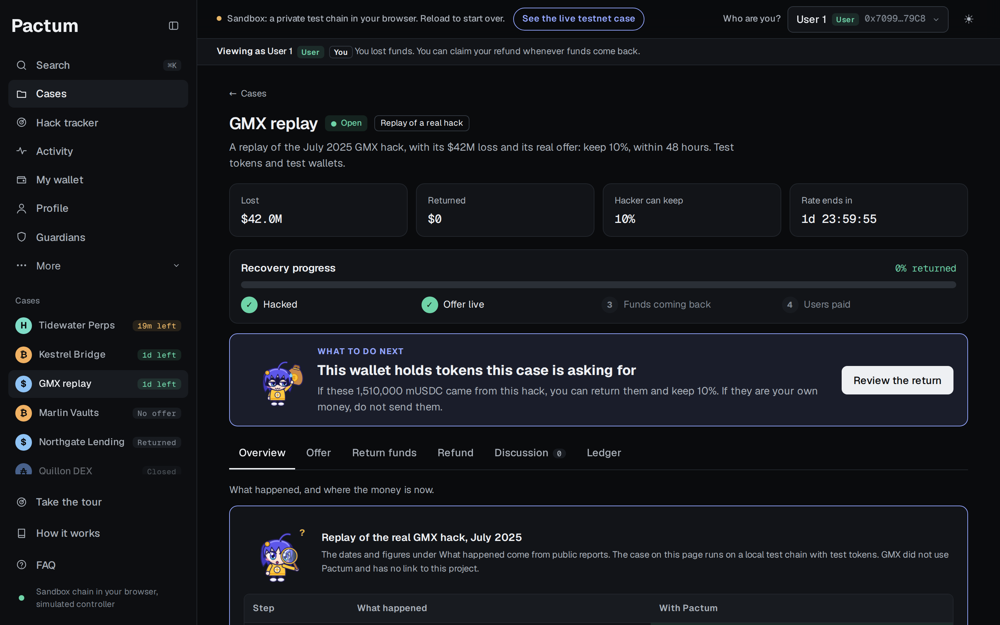
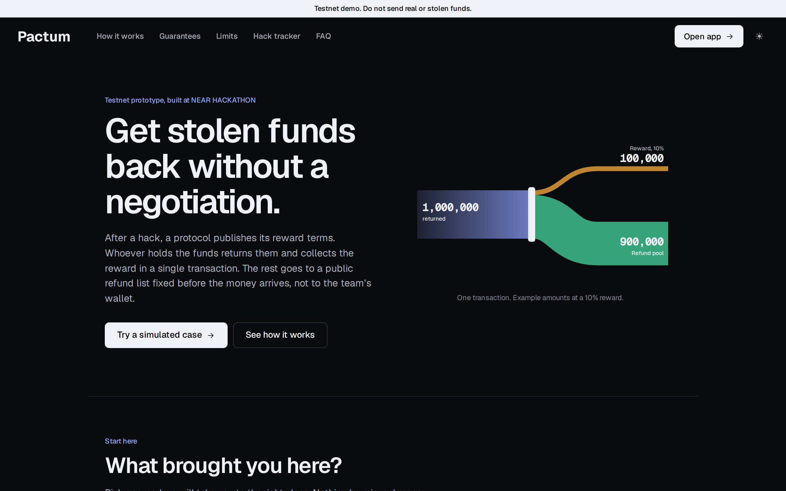

<div align="center">


# Pactum



<p>
  <a href="https://cookiez-1909.github.io/Pactum/"></a>
  <a href="https://cookiez-1909.github.io/Pactum/?live#/cases"></a>
  <a href="https://x.com/Cookiez1909/status/2120326982953312640"></a>
  <a href="#try-it-in-2-minutes"></a>
  <a href="https://nearhackathon.com"></a>
</p>

<a href="https://github.com/cookiez-1909/Pactum/actions/workflows/ci.yml"></a>

</div>

Pactum lets whoever holds exploited funds return them and receive a published reward in one transaction, while the rest becomes refunds that users claim directly. It removes the step where a hacker and a protocol team each have to go first, and it reduces how much users have to trust the team after a hack. Users still rely on the refund list being honest.

Built at NEAR HACKATHON. Testnet prototype with fake tokens, not audited. **Do not send real or stolen funds.**

## Pactum in 60 seconds

- **The problem.** TRM Labs counted 207 crypto hacks in the first half of 2026, about eight a week. After a hack, protocols often post "return it and keep 10%", and then nobody wants to go first: the holder fears getting nothing, the protocol fears paying first, and users fear the money never reaches them.
- **What Pactum does.** The protocol publishes an offer on a contract. Whoever holds the funds sends them in, and one transaction pays the reward and books the rest for users, who claim it with a Merkle proof. The contract has no owner and no withdraw function, and the holder sets a reward floor, so a lower reward reverts instead of paying less.
- **What NEAR does.** Guardians read and approve an offer once on NEAR, and Chain Signatures signs it for every EVM chain it covers, from an address with no private key. Operators stake NEAR in a registry, anyone can challenge them, and a council can slash the stake. NEAR Intents gives users live quotes to swap a refund to another asset and chain.
- **What it does not do.** It cannot force a hacker to return funds, it gives no legal immunity, the team still writes the refund list, and it runs on testnet without an audit.
- **Check it yourself.** `make setup` then `make verify` re-checks every claim above from public testnet data, with no wallet.

| | |
| --- | --- |
| PactumController (NEAR testnet) | [`ctrl-4944dd8b.rd-guardian-b-90c085b48d.testnet`](https://testnet.nearblocks.io/address/ctrl-4944dd8b.rd-guardian-b-90c085b48d.testnet) |
| Controller address, the same on all three chains | `0xC1cAc141a7F02706DE80eaC1Ba8615929849E412` |
| Pactum (Sepolia) | [`0xfbe38f4ecc4d3bb9ab0b66589dfd69caab76070a`](https://sepolia.etherscan.io/address/0xfbe38f4ecc4d3bb9ab0b66589dfd69caab76070a) |
| Pactum (Base Sepolia) | [`0xf3420846de6c84673cc41363b584c41bed1273d9`](https://sepolia.basescan.org/address/0xf3420846de6c84673cc41363b584c41bed1273d9) |
| Pactum (Robinhood testnet, added by a guardian vote) | [`0xd2bb1f7fb56ed077d21268d3ac99f2b54e7b4652`](https://explorer.testnet.chain.robinhood.com/address/0xd2bb1f7fb56ed077d21268d3ac99f2b54e7b4652) |
| PublicNotes (Sepolia) | [`0x99c234f1fa2f4b68bb2133e35e06dfa53a15a428`](https://sepolia.etherscan.io/address/0x99c234f1fa2f4b68bb2133e35e06dfa53a15a428) |
| MockUSD (Sepolia) | [`0x13fee36566a3a749e689f10c3240d67628095039`](https://sepolia.etherscan.io/address/0x13fee36566a3a749e689f10c3240d67628095039) |
| VulnerableVault (Sepolia, intentionally buggy) | [`0x2ca073462d9fe8b73093c53c2320f50edb3b8e82`](https://sepolia.etherscan.io/address/0x2ca073462d9fe8b73093c53c2320f50edb3b8e82) |
| The one transaction | reward and refund split on [Sepolia](https://sepolia.etherscan.io/tx/0x0624cd4238ef8d4e94c97e63265db87f4364e76191d4d85ada8bfd8b227d5f03), [Base Sepolia](https://sepolia.basescan.org/tx/0xa8d288b34372793c073784ed47da41a9bb510c602c6a6cba07d28837f28b3691) and [Robinhood testnet](https://explorer.testnet.chain.robinhood.com/tx/0x11c83ba3a2f49138c2d37b71810478d326414138b85af7ce2a2341ed8ca33b6d) |
| One approval, three signatures | [`Cx2DDSJa…`](https://testnet.nearblocks.io/txns/Cx2DDSJaDfdVgyB3WNezNHG7keSTNNTT4oU68dDpevGu) |
| A signed offer, cancelled | [`GhHsjHZ5…`](https://testnet.nearblocks.io/txns/GhHsjHZ5f5tQeXhVWTwCejRWf5zSWk2DCXWgPoE7cHPB), the final cancel vote on a 12-case offer |
| Video and X post | [Demo video on X](https://x.com/Cookiez1909/status/2120326982953312640), with the problem, the product walkthrough and the GMX replay |
| Hosted demo | [cookiez-1909.github.io/Pactum](https://cookiez-1909.github.io/Pactum/) runs a private test chain in your browser with the same cases, test accounts and GMX replay as `make web-local`, so you can return, claim and publish an offer. Reloading starts over. [The live testnet case](https://cookiez-1909.github.io/Pactum/?live#/cases) reads the real Sepolia and NEAR contracts |

Every transaction is listed in [`deployments/sepolia.json`](deployments/sepolia.json), [`deployments/base-sepolia.json`](deployments/base-sepolia.json) and [`deployments/robinhood-testnet.json`](deployments/robinhood-testnet.json) and [`deployments/drill.json`](deployments/drill.json).

## One return, start to finish

<div align="center">

<br /><sub>The GMX replay in the local demo: one transaction pays the 10% reward and books the rest for users. Test tokens.</sub>
</div>

<table>
  <tr>
    <td width="45%"></td>
    <td><b>The same split, for real, on Sepolia.</b><br /><br />Transaction <a href="https://sepolia.etherscan.io/tx/0x0624cd4238ef8d4e94c97e63265db87f4364e76191d4d85ada8bfd8b227d5f03"><code>0x0624…5f03</code></a> took back 1,000,000 mUSD, paid the 100,000 reward to the holder and booked 900,000 for users, who then claimed all of it. The terms were signed by the NEAR controller through Chain Signatures.<br /><br /><code>make verify</code> re-reads every one of these numbers from public testnet data.</td>
  </tr>
</table>

<table>
  <tr>
    <td width="50%"><br /><sub><b>Return funds.</b> The holder sees exactly what they keep and what goes to users, and can check the offer before sending.</sub></td>
    <td width="50%"><br /><sub><b>Refund.</b> Users claim their share with a Merkle proof. Nobody can redirect the pool.</sub></td>
  </tr>
  <tr>
    <td width="50%"><br /><sub><b>Profile.</b> NEAR Intents quotes a refund into another asset on another chain. Quotes only; no swap runs on testnet.</sub></td>
    <td width="50%"><br /><sub><b>Guardians.</b> Read live from the NEAR controller: one approval signs the offer for every chain.</sub></td>
  </tr>
  <tr>
    <td width="50%"><br /><sub><b>A real hack, replayed.</b> The July 2025 GMX exploit and its real offer, run on Pactum with test tokens.</sub></td>
    <td width="50%"><br /><sub><b>Landing page.</b> What Pactum does, who it is for, and its limits, before anyone opens the app.</sub></td>
  </tr>
</table>

## Try it in 2 minutes

You need `git`, `make`, [Foundry](https://getfoundry.sh), Rust, Node.js 22 or newer and network access. No wallet and no keys.

```text
make setup        → installs submodules and npm packages
make demo-local   → log contains: stolen 1,000,000; reward 100,000; refund pool 900,000; claimed 900,000
make verify       → reads the existing testnet transactions, prints 93 checks marked PASS across the three chains and NEAR, then a PASS summary. Old NEAR transactions are read from an archival node, set by `NEAR_ARCHIVAL_RPC`
```

In a clean-room run on a machine with cached Rust crates, these three took about a minute. Warnings from `npm ci` do not stop the setup.

Then, if you want more:

```text
make test         → all tests pass: 91 in Foundry, 124 in Rust (83 for the controller, 41 for the registry), 7 for the refund list tool. Took 3 to 5 minutes, mostly compiling Rust
make scenarios    → 22 simulated situations on Anvil with real transactions and time travel, all marked PASS
make intents-quote → prints a live NEAR Intents quote, no wallet and nothing is swapped
make web-local    → serves http://localhost:5173 with 5 fictional hacks and one marked replay of the real GMX hack, across 8 mock assets. Pick a test account, then write an offer, return funds or claim. Open Guardians to read the real offers live from NEAR testnet
```

`make web-local` uses ports 5173 and 8546 and runs until you press Ctrl-C.

What to try in the app:

- **First visit:** opening the app asks if you are a User, a Hacker or a Protocol, then shows you around in three or four short steps. You can skip it, or reopen it with "Take the tour" in the sidebar.
- **Case "GMX replay":** the July 2025 GMX hack next to what the same terms would do on Pactum. As the Hacker wallet, Return funds pays $4.2M and books $37.8M for users in one transaction. Figures for the real hack link to their sources.
- **Profile:** claim every refund that is ready from one list, and choose the asset and chain you want refunds quoted in through NEAR Intents.
- **More > Stats:** totals for the whole app, recovery for each case, and the numbers of the selected wallet.
- **More > Stake:** the operators staked in the NEAR testnet registry, read live.

`make demo-local`, `make scenarios` and the cases in `make web-local` run on Anvil with a **simulated** controller: a local test key replaces NEAR. Only `make demo-testnet`, `make verify` and the Guardians page involve the real NEAR contract. The Guardians page reads it live, even in `make web-local`.

`make demo-testnet` runs the whole story on testnet: the same hack on Sepolia, Base Sepolia and Robinhood testnet, guardians voting Robinhood testnet into a controller that started with two chains, one approval round on NEAR for one offer, then a return and refunds on each chain. Then a drill: guardians replace a member and vote them back, sign the largest offer the contract allows, cancel it, and revoke it on all three chains. It costs about 3 NEAR, because it deploys a new controller. Then run `make registry-testnet`, which deploys a registry for that controller, stakes 0.6 NEAR and runs two drill challenges. It costs about 3.5 NEAR. It needs a key funded with ETH on all three chains in `.env` (see [`.env.example`](.env.example)) and `cargo-near`. The NEAR faucet limits how many accounts one machine can create, so the script reuses guardian accounts between runs.

```bash
cargo install cargo-near --locked --version 0.23.0 --no-default-features
```

`make demo-stage` creates a new hack and a new offer on the same controller and `Pactum` contracts, so it only costs gas. It stops with one of two guardian approvals. Then run `cd web && npm run dev`, choose Guardian B under "Who are you?", approve on the Guardians page, send the signature to Sepolia, and return and claim in the app. It does not change `deployments/`.

`make faucet ACCOUNT=<id>.testnet` asks for 5 testnet NEAR the same way as the [NEAR docs faucet](https://docs.near.org/getting-started/faucet), and it is rate limited in the same way.

## The problem

After a hack, a protocol often posts an on-chain message such as "return 90%, keep 10%". That negotiation has three weak points:

- The hacker fears returning the funds and getting nothing, or being identified while making contact.
- The protocol fears paying first and receiving nothing back.
- Users fear the money reaches the team's wallet and is never shared out fairly.

Hackers have returned funds after such negotiations, for example at [Euler](https://www.coindesk.com/business/2023/04/03/euler-says-all-recoverable-funds-stolen-in-200m-hack-have-been-returned) and [Poly Network](https://blockworks.co/news/poly-network-hacker-returns-600-million-offered-500000-bug-bounty). Those were manual processes with no contract enforcing the outcome.

## How it works

```text
Attacker returns 1,000,000 mUSD at a 10% reward, in one transaction
├─ 100,000 mUSD → reward address chosen by the attacker
└─ 900,000 mUSD → refund pool, claimed by users with Merkle proofs
```

```text
Guardians (several NEAR accounts)
      │ propose_offer: one text, one case per token per chain. approve_offer: once
      ▼
PactumController on NEAR testnet
      │ checks the text against its hash, hashes the terms of each case for its
      │ own chain, requests one signature per case
      ▼
Chain Signatures (v1.signer-prod.testnet)
      │ EIP-712 signatures, stored on NEAR for anyone to read
      ▼
Anyone relays each signature to its own chain (the relayer needs no trust)
      ▼
Pactum on Sepolia, Base Sepolia and Robinhood testnet (one contract on each, same controller address)
      ├─ openCase(terms, signature)
      ├─ returnFunds(): atomic split
      └─ claimRefund(): users claim with a Merkle proof
```

The split lives in the EVM contract because NEAR cannot read EVM state by itself. Sending funds to a Chain Signatures address and splitting them later would require trusting someone to report the result, and it would lose atomicity.

Formulas:

```text
reward = min(rewardBps × received / 10000, rewardCap − rewardPaidSoFar)
refund = received − reward
claimable = allocation × totalRefund / totalLoss − alreadyClaimed
```

Properties enforced by [`Pactum.sol`](contracts/src/Pactum.sol):

- The reward and the refund booking happen in the same transaction.
- The holder sets `minReward`. If the reward would be lower when the transaction lands, for example after a deadline or because another return used up the cap, it reverts and no token moves.
- No reward fund is needed: the reward comes out of the returned money.
- The reward falls over time and `returnFunds` reverts after the last tier.
- Terms cannot change after `openCase`. An offer that was signed but not opened can be revoked with `revokeNonce`, and only with a signature from the controller.
- There is no owner, no upgrade path and no withdraw function. Tokens leave only through `returnFunds` and `claimRefund`.

## Who can return and who can claim

Two questions come up first when trying the app.

**How does a hacker prove they are the hacker after mixers and many wallets?** They do not have to. The contract never asks who took the funds. Tokens are interchangeable, so it only counts what arrives. A wallet with no visible link to the hack can return the funds, and the reward can go to any other wallet. A test and a scenario run exactly this: funds moved through several wallets are returned from an unrelated one.

This does not open a way to take money. `returnFunds` pulls only the caller's own tokens, and the most that comes back is the published reward, so someone sending in 100 at a 10% reward loses 90. The interface blocks a wallet that holds none of the token.

**The real limit is the chain.** A case accepts one token on one chain. One offer can open cases on every chain where `Pactum` runs, which in this demo means Sepolia, Base Sepolia and Robinhood testnet, and guardians can vote in another EVM chain. Funds that went anywhere else must be swapped or bridged back first.

**Is any identity needed?** No sign-up and no identity check. The reward wallet is optional and defaults to the sending wallet. Entering a wallet in the interface is optional too. It is a read-only view, is not saved, and is only used to read public data.

**Who can open an offer?** Nothing on chain says who runs a protocol, so there is no owner to look up. Anyone can ask, and guardians decide who to believe. They need at least two of these, all from before the hack: a signature from the owner or multisig of the hacked contract, a post from the known official account, or a known auditor or security group vouching for the team. Only then do guardians propose an offer, and `propose_offer` rejects anyone who is not a guardian. An anonymous team with no admin key may not be able to pass, and this is human judgment that the contract cannot check. A link alone would prove nothing, because anyone can copy one. Guardians give the team a new code, and the team publishes it with the contract address from its official account, or signs it with the protocol's admin wallet. In this demo, the registration step exists only as a screen: any wallet can start it, nothing is sent or saved, and two buttons stand in for the guardians' decision. The "Protocol owner" account is only a test account.

**How does a holder know an offer is real?** The Return funds tab has a "Verify this offer" box. It checks in the browser that the contract is on Pactum's published list, that the case is in a proposal on NEAR (testnet only), and that the refund list adds up to the total loss and matches the signed root. The fourth check is for the holder to do alone: open the protocol's official account and look for the post with this address and code. In this demo that post is simulated. A fake site could draw the same green marks, so the box says to confirm elsewhere.

**Who decides the terms?** The protocol owner writes an offer: how much the holder keeps, the deadlines and any special conditions. In the real flow, guardians must approve it on NEAR before anything is signed. Once published, the offer cannot be lowered, even by its author.

The percentage and the deadlines can be any custom value within the limits. The controller rejects more than 20%, and deadlines go up to 365 days. A case also has a reward cap per asset, so the payout can be lower than the percentage suggests. The interface says so when the cap applied.

"The hacker keeps 20% and returns 80%" is a 20% reward. The holder sends everything to the contract and gets 20% back in the same transaction, which gives the same result but nobody has to go first.

Special conditions are free text. They are hashed into the signed terms through `evidenceHash`, so anyone can check they were not changed. On NEAR the full text is stored in the proposal, and `propose_offer` rejects text that does not match the hash of every case, so guardians read what they approve and one offer cannot say different things on different chains. **The contract does not enforce the conditions**, only the reward, deadlines and refunds.

**Why can the contract accept a claim from anyone?** A claim must carry a Merkle proof that the wallet and amount are on the list fixed when the case opened, and the tokens go only to that listed wallet. Letting someone else submit the transaction helps a user with no gas. The interface shows the claim button only to the listed wallet, and a test confirms that a claim sent by a stranger pays only the listed user.

## When something goes wrong

**The guardians signed something wrong.** Until a case opens, they can vote to cancel with `vote_cancel`, by the same threshold. Cases not yet signed are dropped and their ids can be used again. Cases already signed get a revocation signature that anyone can send to `revokeNonce`, which burns the nonce so the old signature stops working. **This is a race:** the original signature is public, so someone who wants the case open can open it first. Once a case is open, nothing can undo it, because that is the promise to the holder. In the drill, a 12-case offer was signed in 53.4 seconds and 12 revocations took 51.3 seconds, and `make verify` confirms each old signature now fails on its chain.

**A guardian loses a key or leaves.** `propose_guardians` and `approve_guardians` replace members and the threshold by the current threshold. Votes from someone who has left stop counting, including on pending offers. A vote cannot change the signing address, the reward limit or a chain already served. **If more keys are lost than the threshold allows, there is no recovery.** `Pactum.controller` is fixed, so `Pactum` must be deployed again on every chain. Cases already open keep working, because they no longer need the controller.

**The refund list is wrong.** It cannot be fixed after a case opens, so [`make refund-list`](scripts/refund-list.ts) catches what it can first. It reads a CSV, or rebuilds balances from `Transfer` events into the protocol, rejects bad rows and stops when the total does not match the loss. `make verify` rebuilds the demo's list from public events and gets the same `refundRoot` on all three chains. It only knows direct token transfers, so routers, nested vaults and fee-on-transfer tokens need checking against the protocol's own records.

**The list is not ready yet.** The list must exist before the case opens, so a binding offer cannot go out until it does. This is deliberate. Setting the list after the money arrives would let whoever signs it send the refunds to themselves, which is the risk this project exists to remove.

**The hacker swapped the stolen token.** A case takes one token, so guardians open a case in the token the holder has. `--scale-to` rescales the same shares to a new total, so each user keeps their share. The contract has no oracle: the exchange rate behind that total is the protocol's decision. Native ETH must be wrapped first.

## Comments and offer text with no server

[`PublicNotes`](contracts/src/PublicNotes.sol) only emits an event with a topic, an author and some text, and the app reads those events back. Everyone sees the same data, and the site can stay static.

- **Discussion.** The author is the wallet that sent the comment, so the "Lost funds" label, which means the wallet is on that incident's refund list, cannot be faked. Posting costs gas, a comment cannot be deleted, and there is no moderation.
- **Offer text.** Anyone can post a note, but the app only accepts text whose hash matches `evidenceHash` in the signed terms.

## Assets

`Pactum` works with any ERC-20 on its own chain, in the token's smallest unit, so decimals do not change the formulas. The demo uses mock tokens: mBTC (8 decimals), mETH and mHYPE (18), mADA and mUSDC (6). `rewardCap` is a token amount, so no price oracle is needed.

- **Mock tokens are not the real assets.** They are ERC-20 stand-ins with no value.
- **Native assets are not supported.** Native BTC and ADA have no such contract on this chain, and native ETH would first need wrapping. Real use needs a wrapped ERC-20 of the asset on the chain where `Pactum` runs.
- **One case per token.** The interface groups them into one hack, but the contract keeps one case for each token. Opening, returning and claiming all take one transaction per token.

## How NEAR is used

**Money at stake, as in Hyperliquid's HIP-3.** Anyone can deploy a copy of Pactum, so a copy alone proves nothing. [`PactumRegistry`](registry/src/lib.rs) is a NEAR contract that lists only operators who staked NEAR. To register, a guardian of a controller attaches the stake, and the registry asks that controller on NEAR whether the caller really is one of its guardians. Anyone else is refunded, so nobody can claim someone else's controller. Anyone can open a challenge with public evidence and a deposit. A council decides by threshold: dismiss, and the challenger loses the deposit, or slash a percentage, and the challenger gets it back. A 100% slash bans that controller for good. Slashed NEAR stays in the registry forever, which has no access keys and no function to move it, so a slash pays nobody, as in HIP-3 where slashed stake is burned. An operator who asks to leave drops off the list at once but stays slashable for 7 days, and cannot leave within 183 days of joining. A challenge nobody decides within 30 days can be closed by anyone, so it cannot block a withdrawal forever. On testnet, a stranger's attempt to register the live controller was refused and refunded, a guardian staked 0.6 NEAR, one drill challenge was dismissed and another slashed 10%, and `make verify` checks all of it. The Return funds tab shows whether the operator has money at stake.

- **One approval for every chain.** An offer is one text plus one case for each token on each chain, up to 12 cases. Guardians approve it once, and [`PactumController`](controller/src/lib.rs) requests a separate signature for each case. One transaction can start 3 signatures, and `retry_signature` signs the rest of a larger offer or retries a failure, without touching signatures already made. A separate multisig on each chain would need a round of signatures per chain. In the testnet run, one approval produced 3 signatures in 9.1 seconds, and a 12-case offer took 53.4 seconds.
- **One set of rules, and new chains by vote.** All chains share the guardians, the 2-of-3 threshold, the 20% reward limit and the signing address. `propose_chain` and `approve_chain` add a chain by the same threshold and keep the address, even though the contract has no keys left. A vote cannot replace a chain already served. In the testnet run, the controller started with Sepolia and Base Sepolia, and guardians voted in Robinhood testnet. Each digest binds the chain id and the contract address, so `make verify` confirms that a Sepolia signature is rejected on the other two.
- **Chain Signatures: control without a private key.** `Pactum.controller` is an address derived from the NEAR contract account. Its signature comes from the MPC network, only when the contract asks. `make verify` checks the derivation and that the signature recovers to that address on each chain.
- **NEAR smart contract: where an offer is read and approved.** The contract holds the rules, validates the terms and computes each EIP-712 digest itself. Each proposal stores the full offer text, and the contract checks it against `evidenceHash`. There is no function that signs an arbitrary payload, so it can only sign the digest of approved terms, or the revocation of an offer the guardians voted to cancel. Whoever proposes pays for the storage with an attached deposit, and the excess is refunded, so the contract's balance is not drained over time.
- **A public record with no server.** The Guardians page in the app calls `get_config`, `list_proposals`, `list_chain_proposals` and `list_guardian_proposals` on the NEAR contract from the browser, recomputes each offer's hash there, and reads back from each EVM chain whether the case is open.
- **A contract account with no access keys.** After deployment every key of the controller account is deleted, and `make verify` confirms this. Nobody can change its code or act as it. The account was created as a sub-account to avoid the faucet limit, and [a parent has no control over its sub-accounts](https://docs.near.org/protocol/accounts-contracts/account-id).
- **NEAR Intents: refunds in the asset a user wants.** The refund page requests a live quote to swap a refund for an asset on another chain, such as BTC on Bitcoin. `make intents-quote` does the same from the terminal. These are real `dry` quotes at mainnet prices. **No swap runs**, because NEAR Intents has no testnet and the demo tokens are mocks. Real use would have to follow the 1Click terms, which require compliance screening from integrators.

Pactum deliberately does not route the holder's stolen funds through NEAR Intents. Public swaps can be matched between deposit and withdrawal, its SHIELD layer can delay flows linked to reported hacks, and its terms prohibit laundering. Hiding that trail is not a goal of this project.

The digest matches byte for byte across three independent implementations. viem generates [test vectors](contracts/test/vectors/case_terms.json), and both Solidity and Rust are tested against them. Across 14 single signatures on an earlier version of the contract on testnet, the MPC network took 8.7 to 11.7 seconds, measured from the final approval to the stored signature.

**Honest limit of this design.** The money and the split stay on the EVM chains. NEAR decides which offers may open, and nothing else: a holder returning funds and a user claiming a refund never touch NEAR. A separate multisig on each chain could do something similar, and it is the fair comparison. There are two differences. `PactumController` rejects terms above the reward limit, or with an invalid schedule or mismatched text, on every chain and even if enough guardians approve, while a multisig signs whatever enough signers approve unless a guard contract is added on each chain. And one approval covers every chain, while a standard multisig needs a round of signatures per chain. This second difference is not unique to NEAR: [Safe Unified Account](https://docs.candide.dev/account-abstraction/research/safe-unified-account) is a Safe module that signs one Merkle root for several chains, shown as a Sepolia demo and not audited when we read about it. Deploying per chain is not a difference, because `Pactum` itself is deployed per chain. This design has its own costs: guardians still hold their own NEAR keys, someone must relay each signature to its chain, and guardians gain the power to add chains. **This covers EVM chains only.** Chain Signatures can also sign for Bitcoin, but an atomic split needs a smart contract on the same chain as the funds.

## Why not just SEAL Safe Harbor?

[SEAL Safe Harbor](https://frameworks.securityalliance.org/safe-harbor/overview) is the closest existing framework and proves that the industry accepts publishing reward terms in advance. Pactum is meant as an on-chain execution layer that complements it, not a replacement: **Safe Harbor states the terms, Pactum executes the split and the refunds.**

This comparison comes from reading the [SEAL repository](https://github.com/security-alliance/safe-harbor) at commit `78ba923` and its [on-chain adoption guide](https://frameworks.securityalliance.org/safe-harbor/on-chain-adoption-guide). Its Solana folder contains no program source at that commit, so this covers the EVM contracts only.

| | SEAL Safe Harbor | Pactum |
| --- | --- | --- |
| Moves tokens | No, `registry-contracts/src` only stores terms | Yes, receives and splits in one transaction |
| Where funds go | An Asset Recovery Address set by the protocol | A contract with no team withdrawal |
| Changing terms | The owner can call `setBountyTerms`, and SEAL's README warns whitehats to "assume protocols may act adversarially" | Impossible after `openCase` |
| Total cap with a kept reward | Rejected together: `Agreement__CannotSetBothAggregateBountyCapUsdAndRetainable` | Works, because the contract does the split |
| Who it serves | Eligible whitehats rescuing funds from an attack someone else started | Anyone holding the funds, including the original attacker |
| Legal protection | **Yes, SEAL is stronger here:** a legal agreement with a release of claims | **None**, only a payment commitment |
| Cap unit | USD | Token amount, so no price oracle is needed |

Someone holding the funds can also keep 10% and send the rest to the protocol without any contract. Pactum adds only three things to that: a commitment that cannot change, automatic refunds, and no function the team can use to withdraw. We searched public sources and did not find a product with this exact mechanism, which does not prove that none exists.

## Limits and risks

- **A team can hack itself.** It could drain its own protocol and "return" the funds to collect the reward. `rewardCap`, several guardians and public evidence reduce this risk but do not remove it. This is the biggest weakness.
- **No immunity from prosecution.** The contract only commits to a payment.
- **Sanctions.** Paying a sanctioned party may be illegal. Real use needs legal advice and screening, and this prototype has neither.
- **Professional groups may not return funds.** The best fit is an independent hacker at a small or mid-sized protocol.
- **The team writes the refund list.** "No team withdrawal" means no function, not that the team cannot benefit. A dishonest team could add its own wallets to the list, and guardians who are not careful would sign it. The list is fixed and public before any money arrives, so it can be checked, and `make refund-list` rebuilds it from chain data. The Merkle root only proves that an address and amount are in the published list and that the list cannot change later. It does not prove the list is right, and the contract cannot tell who really lost funds. [After the hackathon](#after-the-hackathon) describes one possible way to narrow this gap.
- **Fake offers.** Registration only protects one set of guardians. Anyone can deploy their own `Pactum` and controller with their own guardians, call it the official offer for a real hack, and put their own wallet on the refund list. The contract would run correctly. A holder has to check that the protocol itself published the contract address, and nothing on chain enforces that. A hacked official account defeats this too, which is why guardians should confirm through a second channel.
- **The stake is small and the council is a test.** The testnet stake is 0.54 NEAR: 0.6 NEAR, less a 10% slash in a drill. For real use it would have to exceed what one act of fraud can take, and the registry cannot compare NEAR with a token's value because it has no price oracle. The three council members are test accounts created by the demo script, as sub-accounts of a guardian's account, which gives that account no control over them. Who sits on the council is the same open question as who the guardians are. Unlike HIP-3, there is no fee to pay operators back for locking money, and the council is fixed at deployment with no vote to replace a member.
- **Guardians must check properly.** Off-chain verification is human judgment, and the contract cannot check that it happened. Who chooses the guardians in real use is not decided yet, and a threshold of guardians can vote to replace the others or lower the threshold.
- **The refund list must stay available.** The contract stores only its root, and neither a NEAR proposal (4,096 bytes) nor `PublicNotes` (2,000 bytes) holds a list of real size, so "no server" does not cover it. The file must be hosted somewhere. If every copy were lost, nobody could claim. Anyone with a copy can republish it, and the root proves it is genuine.
- **Demo guardians.** The three guardian accounts on testnet are test accounts controlled by the demo script, so this run shows the mechanism and not independent people.
- **One controller, one set of guardians.** A protocol that wants its own guardians needs its own controller and its own `Pactum` on each chain, about 3 NEAR plus gas each time. There is no shared service for many protocols.
- **Demand is untested.** No hacker or protocol has been asked whether they would use this. There are no customers, and the contract charges no fee.
- **Remaining trust.** `refundRoot` must be correct, and the Chain Signatures MPC network must behave correctly. A wrong root can misallocate that case's refunds, but tests show it cannot pay more than the case's pool or reach another case's tokens.
- **It does not stop hacks.** It only improves the chance of getting money back.
- **Locked tokens.** Tokens sent to `Pactum` without `returnFunds` and rounding dust stay locked, because no withdrawal exists. A reward sent to the contract itself is refused. Allocations that sum to less than the loss leave funds locked as well, and so do refunds nobody claims. A sweep function would remove this, and would also bring back the withdrawal that the design rules out.
- **Token assumptions.** Fee-on-transfer tokens are tested. Tokens whose balances rebase downward are not supported.
- **NEAR binary provenance is partial.** `make verify` proves the deployed code matches [`deployments/pactum_controller.wasm`](deployments/pactum_controller.wasm), and `make verify-wasm` rebuilds that file from source. The rebuild matched byte for byte from another directory on the same machine, with Rust 1.97.1 and cargo-near 0.23.0. It has not been tested on another machine, and it is not a Docker reproducible build.
- **Not audited.**

## After the hackathon

Nothing here is built, and none of it is a commitment. These are the directions that look most worth testing, roughly in the order they would be tried.

- **Check the demand first.** Talk to protocol teams, incident responders and whitehats before building more. If nobody would use a return desk after a real hack, the rest of this list does not matter.
- **Reduce trust in the refund list.** The team writing the list is the largest trust gap left. One possible path: rebuild losses from chain data at the block before the exploit with a published method, starting with simple vaults where `make refund-list` already works; have more than one independent party reproduce the result; allow a window for challenges before guardians sign; and publish the evidence. Its hash could go into the offer record that `evidenceHash` already binds, so this part might not need contract changes. Lending, LP and GLP-style pools are much harder and may never be fully automatic.
- **Real guardians and stakes.** The guardians and council are test accounts. A real deployment would need independent, public guardians with stakes that make fraud costly. Nobody has agreed to take that role.
- **An audit before any mainnet use.** Chain Signatures runs on mainnet (`v1.signer`), but these contracts are not audited and should not hold real funds.
- **Smaller ideas to explore.** A claim that swaps through NEAR Intents in one step, a shared deployment so a protocol does not deploy its own contracts (about 3 NEAR plus gas today), a rule for rounding dust and unclaimed refunds, and offer templates that work alongside SEAL Safe Harbor, with sanctions screening.

## Tests

| Command | Measured result |
| --- | --- |
| `make test-evm` | 91 passed. Fuzz 1,000 runs, invariants 256 runs at depth 64 |
| `cd contracts && forge coverage` | `Pactum.sol`: 100% lines and 100% branches |
| `make mutants` | About 7 minutes. 53 of 53 bugs injected into a copy of `Pactum` were caught. 2 more changes do not alter behavior and are listed in the script |
| `make test-near` | 124 passed: 83 for the controller, 41 for the registry |
| `make test-refund-list` | 7 passed |
| `make scenarios` | 22 of 22 situations on Anvil, including time travel across reward tiers, assets with different decimals, funds moved through several wallets and a team hacking itself |
| `make test-ui` | 235 checks passed. Drives the app in Chromium through every role, offers, returns, refunds, the tour and phones. Needs `npx playwright install chromium` in `e2e/`, or `CHROMIUM_PATH` set |
| `make test-sandbox` | 26 passed: the real NEAR wasm in a local sandbox. 17 run the controller against a **mock** MPC signer, including the largest offer with the longest text. 9 run the registry against the real controller wasm, with real refunds and transfers. The first build took about 8 minutes |

[CI](.github/workflows/ci.yml) runs `make test-evm`, `make test-near`, `make test-refund-list`, the scripts typecheck and the web build on every push to `main`.

Covered as the spec requires: a reward floor against a deadline or another return arriving first, wrong signature, reused signature, wrong chain, tier boundaries, partial returns, `rewardCap`, after the deadline, reentrancy, fee-on-transfer tokens, wrong Merkle proofs, double claims, refunds never exceeding funds, and on NEAR: below threshold, duplicate approval, stranger approval, invalid terms, a chain the controller does not serve, separate digests per chain, offer text that does not match its hash, one failed signature in a multi-chain offer, offers larger than one transaction can sign, a stranger adding a chain, a vote trying to replace a served chain, replacing a guardian, votes from a removed guardian, cancelling before and after signing, a failed revocation, and a proposal with no storage deposit.

The mock signer exists to force failures the real MPC network will not produce on demand: a failed signature, a malformed response and too little gas. After each one the proposal stays recoverable, and anyone can retry signing the same digest. It proves nothing about real signatures. Those are checked by `make verify`, and Foundry also verifies two real MPC signatures from testnet.

"No withdraw function" is checked three ways: a test holds the complete list of allowed functions, `make verify` compares the bytecode on all three chains with this source (excluding immutable values and the unexecuted metadata), and it calls `withdraw` from the controller address with an amount of 0, which would succeed if the function existed.

## Simulated, demo-only and intentionally broken parts

- `make demo-local`, `make scenarios` and the cases in `make web-local`: the controller is a local test key, not NEAR. The output says `SIMULATED`. The Guardians page is the exception, because it reads the real NEAR testnet contract.
- `make test-sandbox`: the MPC signer is a mock that returns a fixed response. It lives in [`sandbox/mock-signer`](sandbox/mock-signer).
- `VulnerableVault`: intentionally vulnerable. `emergencyWithdraw` has no access control.
- `MockUSD` and `MockToken`: anyone can mint them, so they have no value.
- The test accounts in `make web-local` (Hacker, Hacker 2, Hacker 3, New wallet, Users, Protocol owner, Stranger) are demo wallets. On a real deployment nothing would label a wallet that moved funds as a hacker.
- The GMX replay in `make web-local` uses the loss and offer reported for the July 2025 hack, with test tokens and test wallets. GMX did not use Pactum and has no link to this project.
- The hacks in `make web-local` use fictional protocols (Quillon DEX, Kestrel Bridge, Tidewater Perps, Northgate Lending, Marlin Vaults), and their dollar values use made-up prices.
- The registration step before the offer form is a mock. It sends and saves nothing, it is lost when the page reloads, its code is not checked by anyone, and two buttons stand in for the guardians' decision.
- The offer form publishes only in local mode, where a test key signs in place of the guardians. It is not connected to NEAR. On testnet, an offer goes through `make demo-testnet`, which uses real guardian approval but fixed terms. The Guardians page can relay signatures with any wallet that has testnet ETH. It can only vote as a guardian with test keys on the local dev server after `make demo-stage`. Real guardians get a `near` CLI command to run with their own key, because the app has no NEAR wallet connection. That command has not been run on testnet.
- The app acts on one chain at a time. The hosted build can return and claim on Sepolia, and shows the other two runs on the Guardians page and in `deployments/`.
- The comments shown in `make web-local` are written for the demo and posted by test accounts.
- The hosted demo's sandbox replays the transactions of `make web-local` in a [Tevm](https://tevm.sh) chain inside your browser, then keeps its own clock from the last recorded block, so offer deadlines match the recorded data on any day. Nothing is sent anywhere, and the controller is simulated as in `make web-local`. Guardians and Stake still read the real NEAR testnet.
- After `make demo-stage`, the dev server can sign with test guardian keys. Guardian A, B and C appear under "Who are you?", and only the selected guardian gets approve and cancel buttons. Any other account is rejected by the NEAR contract. The keys never reach a production build.
- The Profile choice of where to receive refunds is saved in the browser only. It sets the live NEAR Intents quote shown for a refund. No swap runs, because NEAR Intents has no testnet and the refund tokens are mock. A claim always pays the token that was returned.
- The Stake page reads real data but only operators can stake, with their own NEAR key. Users cannot stake, and do not need to.
- Badges are saved in the browser only and are worth nothing.
- "Hack tracker" in the interface lists real events with figures and links from public sources, as of 2026-11-08. None of those organizations uses Pactum. The "Would it fit?" column is this project's opinion.
- Users, attacker and reward wallets in the demo are test accounts controlled by the demo script.
- [`spike/chain-signatures`](spike/chain-signatures) is the first experiment that proved an MPC signature recovers correctly on the EVM. It is kept as evidence and is not part of the product.

## Repository

```text
contracts/    Solidity contracts and Foundry tests: Pactum, PublicNotes and demo tokens
controller/   NEAR contract in Rust that approves offers and requests Chain Signatures
registry/     NEAR contract in Rust that lists staked operators and slashes them after a challenge
scripts/      demo, verify, scenarios, mutation tests, refund list tool and test vector generation
sandbox/      local NEAR sandbox tests and the mock MPC signer
web/          React app: landing page, tour, cases, offers, returns, refunds, discussion, activity, profile, stats, stake, guardians, hack tracker and FAQ
web/mascot/   source of the mascot animations, drawn in SVG for this project
web-sandbox/  in-browser test chain for the hosted demo, built by make pages
e2e/          interface tests in Chromium
deployments/  public addresses, transaction hashes and the deployed wasm of the testnet run
spike/        first Chain Signatures experiment, kept as evidence
docs/readme/  images used in this README
.github/      CI workflow, contributing guide, security policy and code of conduct
```

Built with Solidity 0.8.30 and Foundry, Rust 1.97.1 and near-sdk 5.30.1, React 19, Vite and viem.

Code comments, identifiers, logs and the interface are all in English.

## Disclosure

All code in this repository was written during the hackathon window, from 2026-11-06. It reuses no earlier project and no template. Much of the code was written with an AI coding tool.

- **AI tools:** Claude Code.
- **Solidity:** [OpenZeppelin Contracts](https://github.com/OpenZeppelin/openzeppelin-contracts) 5.6.1, [forge-std](https://github.com/foundry-rs/forge-std), [Foundry](https://getfoundry.sh).
- **NEAR:** [near-sdk](https://crates.io/crates/near-sdk) 5.30.1, [cargo-near](https://crates.io/crates/cargo-near) 0.23.0, [near-workspaces](https://crates.io/crates/near-workspaces) 0.24.0 for the sandbox tests, NEAR Chain Signatures through `v1.signer-prod.testnet`.
- **TypeScript:** [viem](https://viem.sh) 2.57.16, [near-api-js](https://www.npmjs.com/package/near-api-js) 7.4.0, [@openzeppelin/merkle-tree](https://www.npmjs.com/package/@openzeppelin/merkle-tree) 1.0.8, [@noble/curves](https://www.npmjs.com/package/@noble/curves) and [@noble/hashes](https://www.npmjs.com/package/@noble/hashes) 2.4.0, tsx, TypeScript, [Tevm](https://tevm.sh) 1.0.0-next.148 for the hosted sandbox.
- **Web:** React 19, Vite, Geist fonts from Google Fonts.
- **Testing the interface:** [Playwright](https://playwright.dev) 1.65.0.
- **Reference only:** the [near/mpc](https://github.com/near/mpc) source at the deployed commit, for the signing interface and key derivation.

## License

[MIT](LICENSE)
